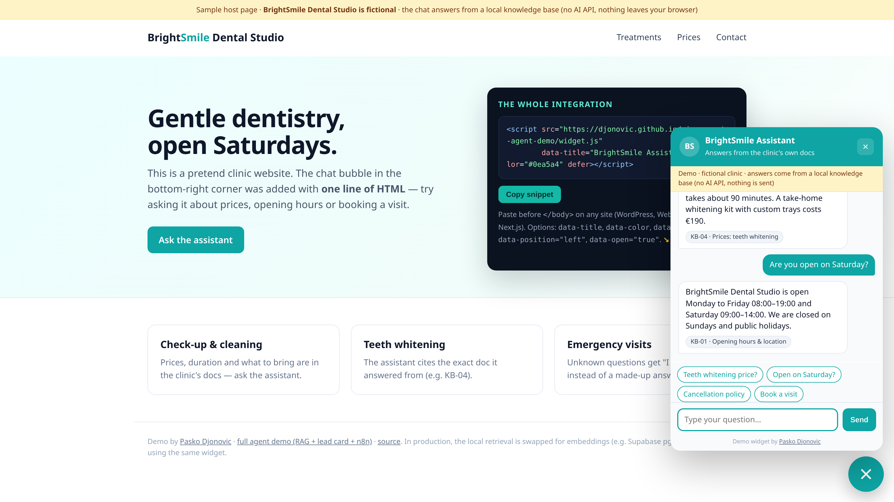

# AI Support Agent + one-line website chat widget — live demo

**Live demo:** https://djonovic.github.io/ai-support-agent-demo/ ·
**Widget on a sample website:** https://djonovic.github.io/ai-support-agent-demo/embed-demo.html

> **In 10 seconds:** a support chatbot that answers only from the business's
> own documents, shows which document each answer came from, says "I won't
> guess" when the answer isn't there, and takes booking requests. It drops
> onto any website with **one `<script>` tag**.

**Demo with fictional data.** "BrightSmile Dental Studio" is not a real clinic; bookings are fake and nothing leaves the browser. Retrieval runs locally in the browser (BM25), so the demo needs **no paid API key**; the production setup is described below.



## One-line embed

```html
<script src="https://djonovic.github.io/ai-support-agent-demo/widget.js"
        data-title="BrightSmile Assistant" data-color="#0ea5a4" defer></script>
```

Paste it before `</body>` on any site (WordPress, Webflow, Shopify, Next.js).
`widget.js` (~4 KB, no dependencies) adds a floating chat bubble and opens the
chat in a sandboxed iframe (`embed.html`), so the host site's CSS can't break
it and it can't break the host site.

| Option | Default | What it does |
| --- | --- | --- |
| `data-title` | `BrightSmile Assistant` | Name in the chat header |
| `data-color` | `#0ea5a4` | Brand colour (hex) |
| `data-greeting` | built-in | First message |
| `data-position` | `right` | `left` puts the bubble bottom-left |
| `data-open` | `false` | `true` opens the chat on page load |

JS API: `BrightSmileWidget.open()` / `BrightSmileWidget.close()`. Mobile: the
chat goes full-width. Test: `python3 test_embed.py <base-url>`.

## Full agent demo (index.html)

A single-page RAG customer-support agent that:

1. **Retrieves**: BM25 search (field-boosted title/tags + synonyms) over a 16-document clinic knowledge base (`site/kb.js`). Runs fully in the browser with no API key.
2. **Answers**: composes the reply only from the best-matching sentences of the retrieved passages and cites the doc ID (e.g. `KB-04`). If nothing relevant is retrieved, it says so instead of guessing.
3. **Qualifies**: extracts name, need, budget and timeline into a live **lead card** JSON with a hot/warm/cold score.
4. **Books**: offers open slots from a fake calendar and confirms with a booking ID.
5. **Hands off**: shows the exact webhook payload that would be POSTed to n8n (simulated).

`n8n/n8n-workflow-template.json` is an **importable n8n template** of the same flow: Webhook → retrieval → LLM (grounded answer + lead extraction, JSON output) → qualified? → Google Sheets append → slot chosen? → Google Calendar event → respond to widget. Credentials and sheet/calendar IDs are `REPLACE_ME` placeholders.

## Production version
Swap BM25 for embeddings (Supabase pgvector), put an LLM on top of the same retrieved passages, and post leads to n8n / Sheets / CRM / a real calendar.

## Run locally
```
cd site && python3 -m http.server 8765
```
Tests (Playwright): `python3 test_demo.py http://localhost:8765/`

Built by Pasko Djonovic: full-stack React/Next.js and AI automation developer.
